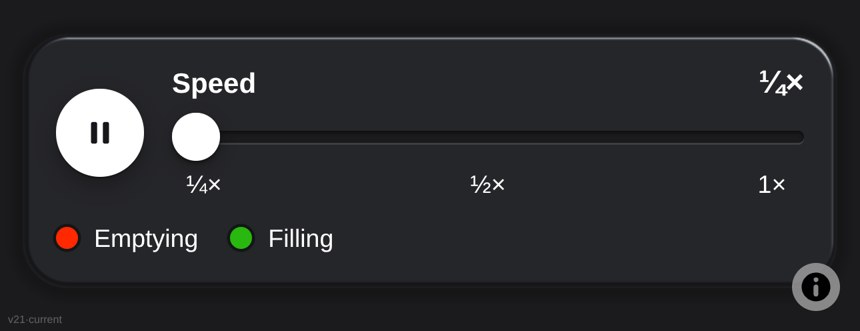

# Glass UI kit: controls that refract the map behind them

By [Blair Zasitko](https://blairz.ca)

**See it in use: https://blairz.ca/pulse/** (move the map under the controls)

Most "glass" interfaces blur whatever is behind them. This one refracts it. The map behind a
pane is bent at the edges and magnified slightly, as it would be through a real piece of
glass. Buttons are separate pieces set flush into the pane, and a button that is switched on
is stained a colour.

## How it works

- **One shader, one pass.** After the map has drawn its frame, the frame is copied to a
  texture and one WebGL shader draws every pane and button through it (`src/glass/`).
  Elements are found by a `data-glass` attribute, so the markup stays ordinary HTML.
- **One file of design values.** Glass optics, palette, fonts, type sizes and control sizes
  are all in `src/tokens.json`; the CSS and JavaScript tokens are generated from it.
- **Frozen releases.** `releases/<version>/` is written once and never edited. An app carries
  a copy of one numbered release, so a change to the kit cannot alter an app by accident.
- **Two skins for the controls**: glass, and an inset "well" for places with no map behind them.

`src/glass/host-maplibre.js` is the host for [MapLibre GL JS](https://maplibre.org/) maps. The
shader itself (`core.glsl.js`) does not depend on MapLibre.

## Use

Copy a release folder into your app, load `ember-ui.css` and `ember-ui.js`, add the glass
layer to your map last, and mark elements with `data-glass`. Tests: `node --test tests/*.test.mjs`.

## Used in

[Pulse](https://github.com/datumsOG/toronto-bike-pulse) ·
[Sun](https://github.com/datumsOG/sun-light-planner) ·
[Toronto apartments](https://github.com/datumsOG/toronto-apartments)

## How it was made

I designed the kit, judged every optical setting by eye on a test bench over a live map, and
directed its construction with AI coding agents (Claude Code).

The code is MIT-licensed (see `LICENSE`). Typeface: Atkinson Hyperlegible Next, SIL Open Font License 1.1.
